# oakestra-github-runner

An [Oakestra](https://www.oakestra.io) addon that lets GitHub Actions run jobs on your own
cluster. You connect GitHub once in the dashboard and then change one line in a workflow:

```yaml
jobs:
  build:
    runs-on: oakestra-4vcpu-ubuntu-2404
    steps:
      - uses: actions/checkout@v4
      - run: make test
```

Each job gets its own runner container. It is started as an Oakestra service when the job is
queued and deleted when the job is done.

This is early software. It has tests, but it has not been through much real use yet, so read
[What does not work](#what-does-not-work) before you move anything important to it.

## How it works

The addon is a single container on the root orchestrator. It serves a few pages in the Oakestra
dashboard and talks to two APIs: GitHub and the Oakestra system manager.

On the GitHub side it uses runner scale sets, the same mechanism as GitHub's own Actions Runner
Controller for Kubernetes, through the [`actions/scaleset`](https://github.com/actions/scaleset)
client. The addon keeps a connection to GitHub open, and GitHub uses it to say when a job is
waiting. Nothing has to reach the addon from the internet, so it also works on a cluster behind
NAT.

A runner size is called a pool. A pool has a name, a number of vCPUs, an amount of memory and a
limit on how many jobs it runs at once. On GitHub a pool is one scale set, and its name is what
you write in `runs-on`.

When a job is queued for a pool, this happens:

1. GitHub tells the addon that the pool has a job waiting.
2. The addon asks GitHub for a one-time runner registration and creates an Oakestra service that
   runs the `ghcr.io/actions/actions-runner` image with it.
3. Oakestra schedules the container on a worker. The runner connects to GitHub and takes the job.
4. When the job ends the runner exits, and the addon deletes the service.

If a runner crashes or never starts, the addon deletes it too and starts a new one if the job
is still waiting. Otherwise Oakestra would keep restarting the dead container.

Connections, pools and the job history are kept in a SQLite file on the addon's volume. Tokens
and keys in it are encrypted.

## What does not work

- Docker inside a job. That rules out `container:` jobs, service containers, actions that are
  built as Docker images, and `docker build`. Oakestra containers cannot run a Docker daemon.
- Resource limits. The vCPUs and memory of a pool decide where a runner fits, but Oakestra does
  not cap the container at those values.
- The preinstalled tools of `ubuntu-latest`. The runner image is GitHub's minimal one on Ubuntu
  24.04. Install what you need with `setup-*` actions, or give the pool your own image.
- Choosing an architecture automatically. Oakestra does not look at the architecture when it
  places a container, so an arm64 pool has to be pinned to a cluster, or to a node, that is
  arm64.

Other things to know:

- A job starts 15 to 30 seconds after it was queued. The first job on a worker takes longer
  because the image has to be pulled.
- Workers need outbound internet access. Oakestra's default overlay network gives them that.
- The runner registration is passed to the container as an environment variable, so the addon's
  Oakestra user can read it. It works only once.
- Runners are containers, not virtual machines. See [Security](#security) before you let
  untrusted code run on them.
- GitHub marks the scale set client as a public preview.
- GitHub announced a per-minute fee for self-hosted runners in private repositories in December
  2025 and then postponed it. Check the current pricing.

## Security

### What is exposed

Nothing new is reachable from the internet. The addon does not open a port on the host and does
not need a public address, a domain or a webhook endpoint. All traffic goes outwards:

- the addon container connects to GitHub to wait for jobs,
- each runner container connects to GitHub to fetch its job and report back,
- workers pull the runner image from `ghcr.io`.

Your cluster, its nodes and the dashboard stay exactly as reachable as they were before. If the
dashboard is only available inside your network, that does not change. The GitHub App setup
works there too, because GitHub only redirects your browser and never calls the dashboard
itself.

The addon's API is only reachable through the dashboard. Every logged-in Oakestra user can read
it, which includes the job history with repository and workflow names. Only admins can change
anything. `GHR_AUTH=off` removes all of that and is meant for a laptop, never for a cluster.

### Jobs run other people's code on your nodes

This is the important part. Anyone who can get a workflow to run on a pool can run commands on
one of your workers. For a private repository that is everyone with push access. For a public
repository it can be anyone who opens a pull request from a fork, which is why GitHub advises
against self-hosted runners on public repositories. By default, public repositories cannot use
an organization's runners. Only change that in the runner group if you know what you are doing.

What a job gets:

- A fresh container that is deleted after the job. Nothing a job writes is there for the next
  one.
- No privileged mode and no access to the node's Docker or containerd socket.
- Only a container, not a virtual machine. Runners share the kernel with the node and with
  everything else running on it. Services like Blacksmith put each job in its own virtual
  machine. This addon does not.
- No CPU or memory cap. A job can use up a node and slow down the other services on it.
- Network access. A runner has to reach the internet, and you should assume it can also reach
  other services on the Oakestra overlay network and whatever the worker can reach on its local
  network. Oakestra has no network policies to prevent that.

If that is too much trust for some repositories, give them their own pool and pin it to a
cluster or node that runs nothing else, and use a runner group on GitHub to control which
repositories may use which pool.

Secrets that a workflow uses are present inside the runner container while the job runs, as on
any self-hosted runner.

### What the addon itself can do

The addon asks for the `core_network` permission, because that is the only way for an addon to
reach the system manager. On that network Oakestra's database and internal services accept
connections without authentication. So treat the addon as part of the control plane: if someone
took over its container, they could do far more than start runners. The container itself runs
as a non-root user, without extra capabilities, host mounts or the Docker socket.

In Oakestra, the addon acts as the user you give it. That user does not need the admin role. It
can create and delete services, and that is all the addon uses it for.

On GitHub, it depends on how you connect:

- A GitHub App on an organization can manage self-hosted runners and nothing else. It cannot
  read code.
- A GitHub App on a single repository needs "Administration", which also covers the
  repository's settings. GitHub offers nothing narrower.
- A classic personal access token needs `admin:org` or `repo`. Both allow much more than
  managing runners, and the token belongs to your account. Use the App if you can.

### Stored secrets

The GitHub App key, tokens and the Oakestra password are encrypted in the addon's database.
By default the encryption key is a file on the same volume. That protects a copy or backup of
the database, but not against someone who can read the whole volume. Set `GHR_ENCRYPTION_KEY`
if you want to keep the key somewhere else.

The one-time runner registration is passed to the runner as an environment variable. It is
stored in Oakestra as part of the service until the service is deleted, and it stops working
once the runner has used it.

The default runner image is `ghcr.io/actions/actions-runner:latest`. Pin a version in
`GHR_RUNNER_IMAGE` if you want to decide when it changes.

## Requirements

- Oakestra with the Go addons engine and dashboard-v2. Both are on the `feat/marketplace-api`
  branch at the time of writing.
- An Oakestra user that only this addon uses. Oakestra has no service accounts, and only the
  user who created a service can see it. If you used your own account, nobody else could see the
  runners.
- Admin rights on the GitHub organization or repository.

## Setup

<details>
<summary>Setup with screenshots</summary>

<br>

This follows steps 2 to 5 below. The dashboard screenshots use made-up data, and `my-org`
stands for your GitHub organization.

#### Overview

After you install the addon, open GitHub Runners in the dashboard sidebar. The overview shows
which setup steps are still open, with a button for each.

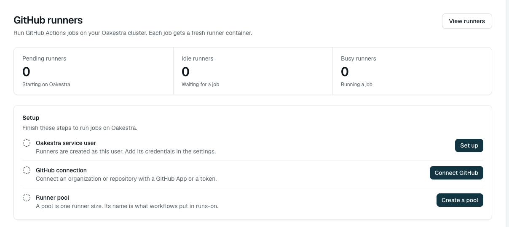

#### Oakestra user

Create a user on the dashboard's Users page. Then enter its username and password under GitHub
Runners > Settings. "Login works" means the addon could log in with it.

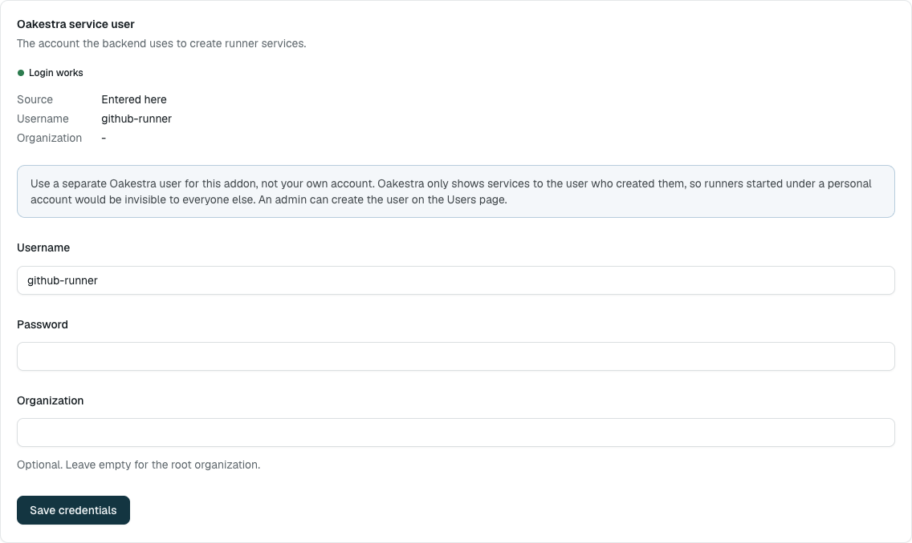

#### Connect GitHub with a GitHub App

In Settings, enter a name for the App and the URL of your organization or repository. Then press
"Continue on GitHub".

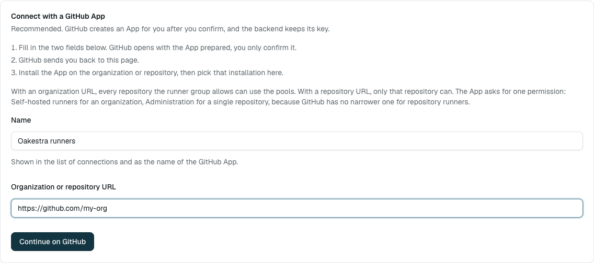

GitHub shows the App with everything filled in. You can change the name if you like. Press
"Create GitHub App for my-org".

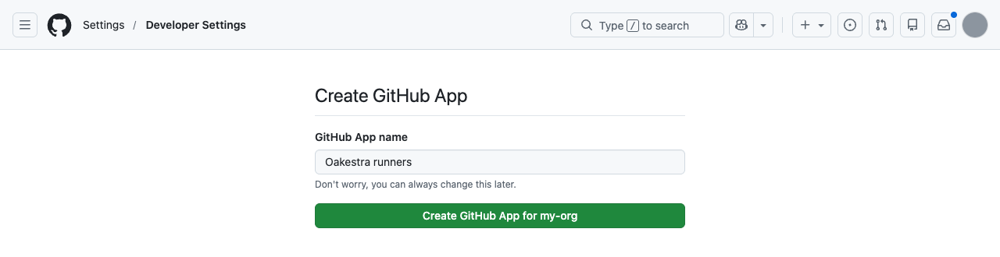

GitHub sends you back to Settings. Press "Install the GitHub App". On GitHub, pick the
organization, choose which repositories may use the runners, and press "Install". Back in
Settings, press "Refresh installations" and then "Use this installation".

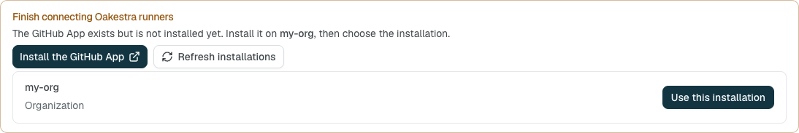

The connection now shows as ready.

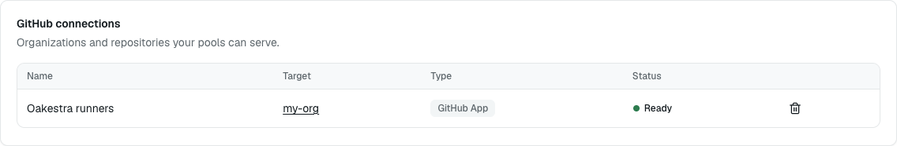

#### Or connect GitHub with a token

If you don't want a GitHub App, use a token instead. The links below open GitHub's token form
with the right settings already chosen. Check the expiry date, press "Generate token", and paste
the token into "Connect with a token" in Settings.

- Classic token for an organization:
  [token with `admin:org`](https://github.com/settings/tokens/new?scopes=admin:org&description=Oakestra+runners).
  For a repository, tick `repo` instead.

  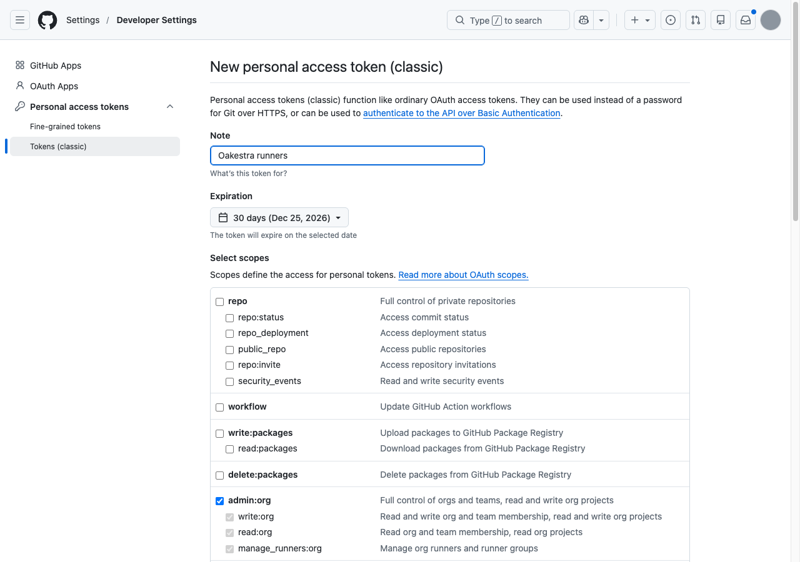

- Fine-grained token for an organization:
  [token with "Self-hosted runners"](https://github.com/settings/personal-access-tokens/new?name=Oakestra+runners&organization_self_hosted_runners=write).
  Choose your organization as the resource owner. For a repository, select the repository and
  add "Administration: read and write" instead.

  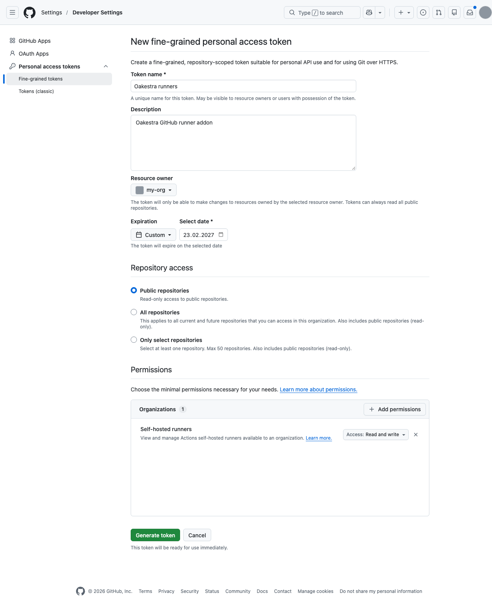

#### Create a pool

On the Pools page, press "Create pool". When you pick a size, the name is filled in for you.
That name is what you put in `runs-on`.

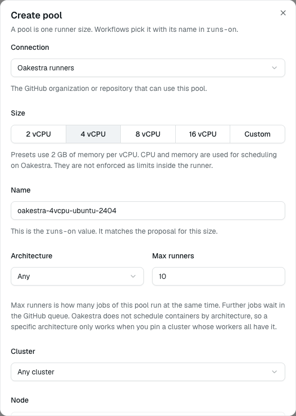

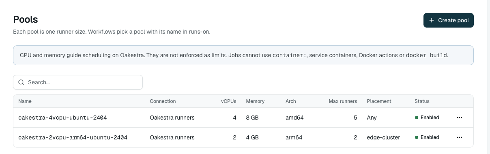

On GitHub, each pool shows up under your organization's Settings > Actions > Runners, in the
"Default" runner group unless you picked another one. The runner group decides which
repositories may use the pool. Leave "Allow public repositories" off unless you have read
[Security](#security).

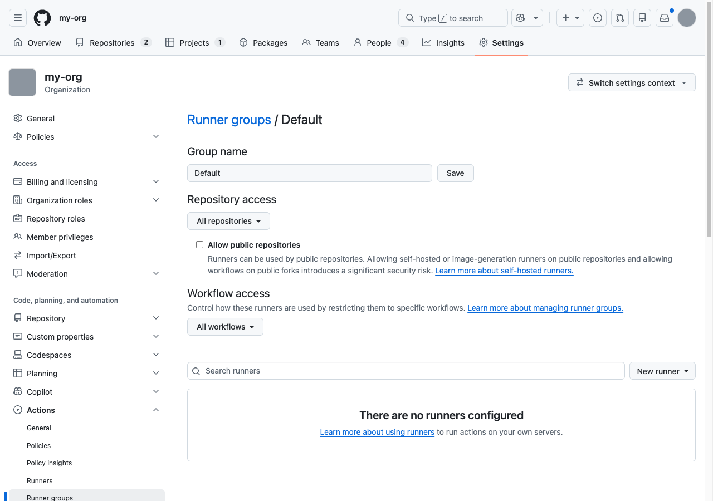

#### Use it

The overview now shows a `runs-on` line for each pool. Copy one into a workflow and push.

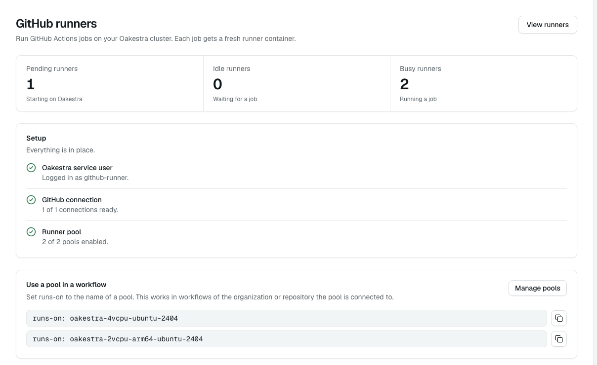

Each queued job gets its own runner. It shows as "Pending" while Oakestra starts it and as
"Busy" while it runs the job. It is deleted when the job is done.

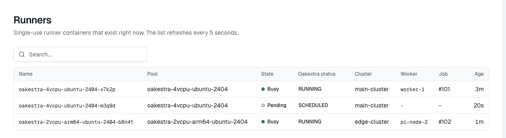

The Jobs page keeps the history.

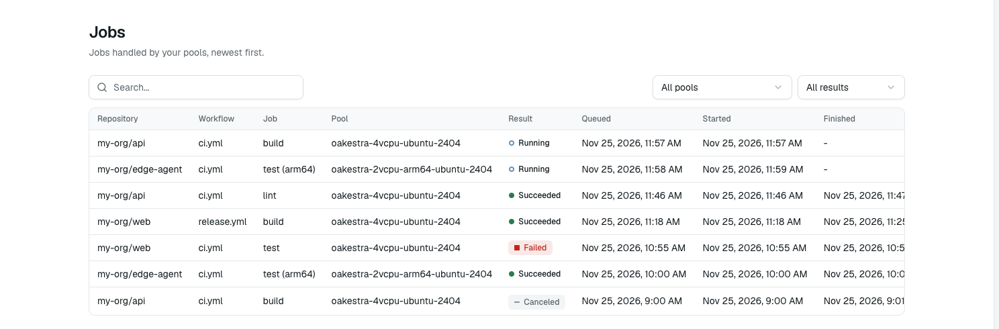

</details>

### 1. Install the addon

Log in as an Oakestra admin and register the definition on the root orchestrator:

```sh
TOKEN=$(curl -s http://<root>:10000/api/auth/login \
  -H 'Content-Type: application/json' \
  -d '{"username": "Admin", "password": "<password>"}' | jq -r .token)

curl -X POST http://<root>:11102/api/v1/marketplace/addons \
  -H "Authorization: Bearer $TOKEN" -H 'Content-Type: application/json' \
  -d @addon/github-runner.json
```

Then open the Addons page in the dashboard and install `local/github-runner`. The dashboard
shows the definition and asks you to confirm it. The addon wants one permission, `core_network`,
which lets it reach the system manager.

If you register the addon locally like this, you need to build the image yourself. The
dashboard only loads an addon's pages if the id built into them matches the id the addons
engine reports. For a local registration that id is `local--github-runner`, but the published
image is built for `github-runner`. So build your own image and put its name into
`addon/github-runner.json` before you register it:

```sh
make image ADDON_ID=local--github-runner VERSION=dev
```

After the install, "GitHub Runners" shows up in the dashboard sidebar. Its overview page lists
the next three steps and ticks them off as you do them.

### 2. Give the addon an Oakestra user

Create a user for the addon on the dashboard's Users page, for example `github-runner`. It does
not need the admin role.

Go to GitHub Runners > Settings and enter the username and password under "Oakestra service
user". The addon tries to log in right away and shows whether that worked.

You can also set `OAKESTRA_USERNAME` and `OAKESTRA_PASSWORD` in the definition instead. Only do
that on a private setup, because the marketplace shows definitions to anyone who can reach its
port.

### 3. Connect GitHub

You can connect an organization or a single repository. With an organization, every repository
that the runner group allows can use the pools. With a repository, only that one can.

A GitHub App is the better choice. The addon only gets short-lived tokens, and nothing is tied
to a person's account:

1. Under "Connect with a GitHub App", enter a name and the URL, for example
   `https://github.com/my-org`, and press "Continue on GitHub".
2. GitHub shows an App that is already filled in. Confirm it. GitHub sends you back to the
   settings page, and the addon stores the App's key.
3. Press "Install the GitHub App" and install it on the organization or repository.
4. Back on the settings page, press "Refresh installations" and pick the installation.

The App asks for one permission. For an organization that is "Self-hosted runners". For a single
repository it is "Administration", because GitHub has no narrower permission for repository
runners.

If you would rather not create an App, use "Connect with a token" and paste a personal access
token. A classic token needs `admin:org` for an organization or `repo` for a repository. A
fine-grained token needs "Self-hosted runners: read and write" for an organization or
"Administration: read and write" for a repository.

### 4. Create a pool

Go to GitHub Runners > Pools and press "Create pool".

- Pick the connection and a size. The form proposes a name such as
  `oakestra-4vcpu-ubuntu-2404`. You can change it, but it has to be unique on the GitHub side.
- "Max runners" is how many jobs of this pool run at the same time. More jobs than that wait in
  GitHub's queue.
- Cluster and node are optional and keep the runners on that cluster or node. You need them for
  an arm64 pool, see [What does not work](#what-does-not-work).
- The runner group has to exist on GitHub already. Leave it empty for the default group.

### 5. Use it

Put the pool name into a workflow and push:

```yaml
runs-on: oakestra-4vcpu-ubuntu-2404
```

The Runners page shows the container while it starts and runs. The Jobs page keeps the history:
repository, workflow, result, how long it took and which cluster and worker ran it.

## Day to day

Disabling a pool stops it from taking new jobs. Jobs that are already running finish. Use this
when you want to drain a pool.

Deleting a pool removes its runners right away, so jobs that are running on them fail. It also
removes the scale set on GitHub. Workflows that still use the name stay queued until you create
a pool with that name again or change the workflow.

Renaming a pool, or moving it to another connection or runner group, is the same as deleting it
and creating a new one.

Deleting a connection is only possible once no pool uses it.

## When a job stays queued

Go through these in order:

1. Wait half a minute. Starting a runner takes 15 to 30 seconds, and the first image pull on a
   worker takes longer.
2. Look at the Pools page. If the pool shows an error, either GitHub rejected the credentials or
   Oakestra could not start the runner. The message says which.
3. Look at the Runners page. Runners that stay "pending" and are replaced by a new one every
   five minutes mean that Oakestra cannot start them: no worker has enough free CPU and memory,
   the pinned cluster or node does not exist, or the image cannot be pulled.
4. Check `runs-on`. It has to be exactly the pool name, with no other labels next to it.
5. Check whether the repository is public. GitHub does not let public repositories use an
   organization's runners until you allow that in the runner group settings.
6. Check "Max runners". The pool may simply be full.

For more detail, look at the addon's log with `docker logs` on the container whose name ends in
`github-runner--controller`.

## Configuration

The addon is configured with environment variables. The defaults work for an addon installed on
the root orchestrator, so normally you don't need to set any of them.

| Variable | Default | Meaning |
|---|---|---|
| `OAKESTRA_API_URL` | `http://system_manager:10000` | Where the system manager is. |
| `OAKESTRA_USERNAME`, `OAKESTRA_PASSWORD`, `OAKESTRA_ORGANIZATION` | not set | The addon's Oakestra user. If set, the settings page shows it read-only. |
| `JWT_GENERATOR_URL` | `http://jwt_generator:10011` | Where to get the key for checking dashboard logins. |
| `JWT_PUBLIC_KEY`, `JWT_PUBLIC_KEY_URL` | not set | Other ways to provide that key. |
| `GHR_RUNNER_IMAGE` | `ghcr.io/actions/actions-runner:latest` | Runner image for pools that do not set their own. |
| `GHR_DATA_DIR` | `/data` | Database and encryption key. |
| `GHR_ENCRYPTION_KEY` | not set | 32 byte key, base64 or hex. Without it the addon creates a key file in the data directory. |
| `GHR_LISTEN` | `:80` | Listen address. |
| `GHR_AUTH` | `jwt` | `off` turns authentication off. For local development only. |
| `GHR_LOG_LEVEL` | `info` | |

A custom runner image has to contain the GitHub runner at `/home/runner/run.sh`. The simplest
way is a Dockerfile that starts `FROM ghcr.io/actions/actions-runner` and adds your tools.

## Development

```sh
make test     # go vet, go test -race, UI typecheck and tests
make build    # UI bundle and binary, in bin/
make run      # backend on :8080 without authentication, data in ./data
make image    # container image
```

The UI packages `@oakestra/*` are on GitHub Packages, which needs a token even for public
packages. [ui/README.md](ui/README.md) explains that, and how to run the UI in a local dashboard
against a local backend.

```text
cmd/ghrunner          entry point
internal/core         shared types, the interfaces between the packages, the list of HTTP routes
internal/controller   listens to GitHub, starts and removes runners
internal/github       GitHub App setup, token checks
internal/oakestra     client for the system manager, and a fake one for tests
internal/store        SQLite
internal/api          HTTP API, login check, static files
ui/                   dashboard pages
addon/                addon definition
```

## Releasing

Push a tag that starts with `v`. CI builds the image for amd64 and arm64 and attaches a
`github-runner.json` to the release, with the version and the image digest filled in. Addon
catalogs only accept images pinned by digest, so submit that file.
